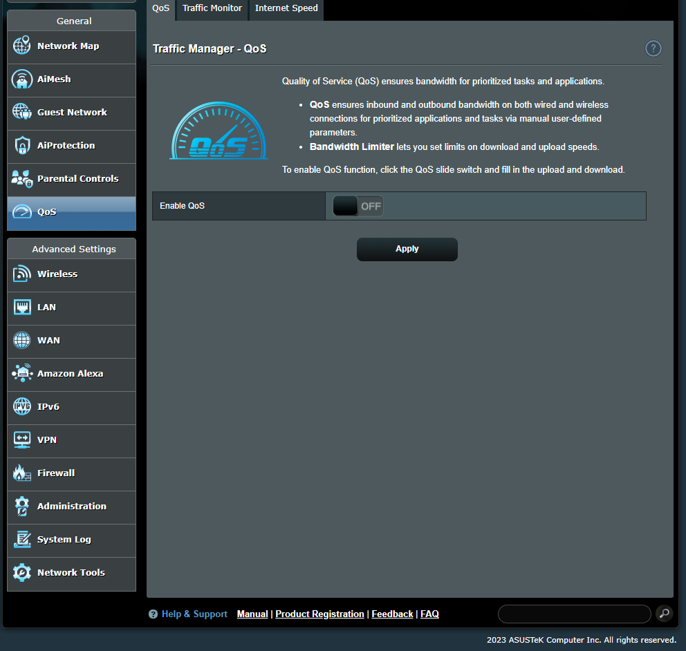
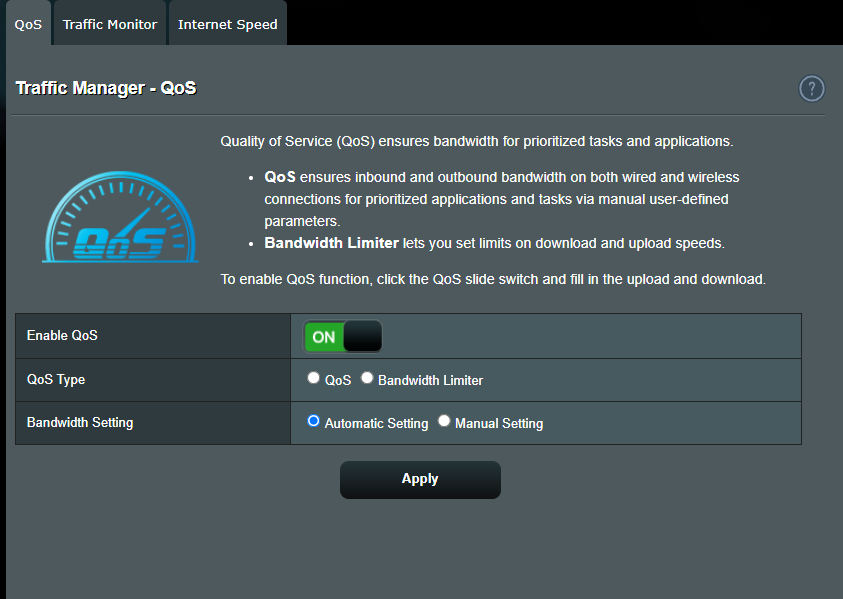
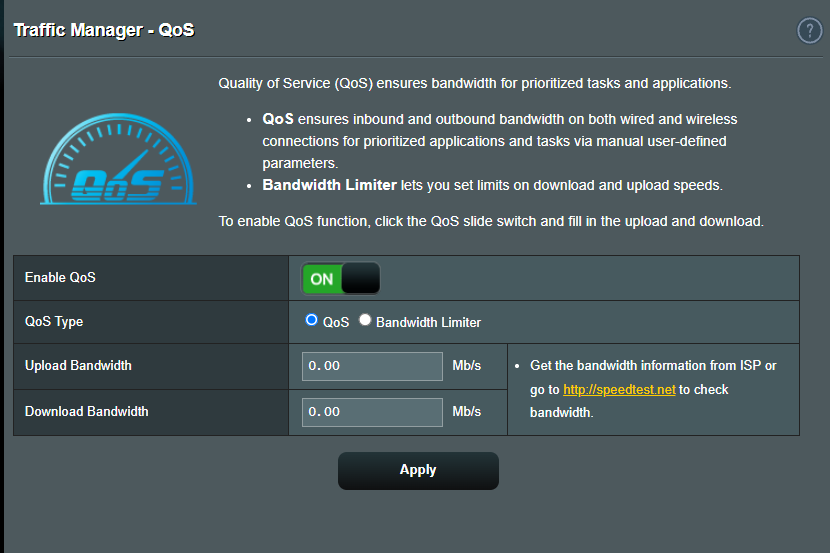
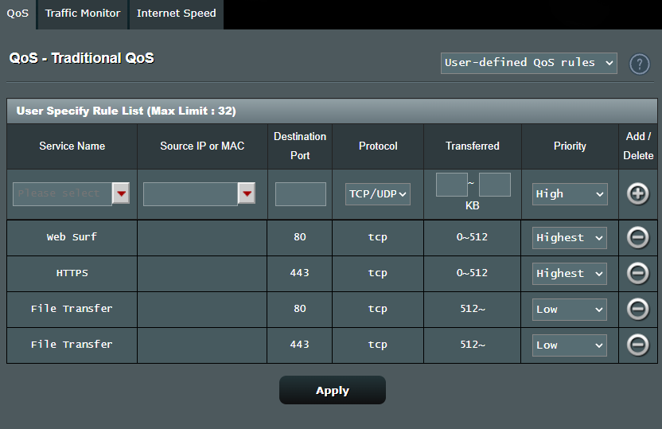
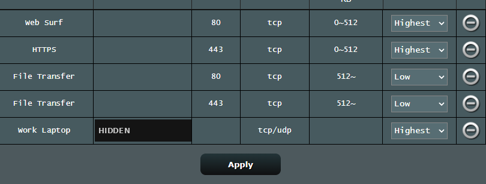

# Stop Video Calls Dropping: Set Up QoS on an ASUS RT-AX3000P Router

*A step-by-step guide for small offices and home workers. By Aditi Rana. Tested November 2026.*

## Who this guide is for

This guide is for small business owners, home workers and anyone whose video calls freeze or drop when other people on the same internet connection are streaming, gaming or downloading. You don't need any technical experience.

## What QoS does, in one sentence

QoS (Quality of Service) tells your router which jobs are most important, so your video call gets internet speed first and the Netflix in the next room waits its turn.

## What you need

- An ASUS RT-AX3000P router (the steps are similar on most ASUS routers)
- A laptop or computer connected to your home or office WiFi
- Your router login username and password (often printed on the sticker under the router)
- About 10 minutes

---

## Step 1: Log in to your router

1. Open your web browser (Chrome, Edge or Safari).
2. In the address bar, type **router.asus.com** and press Enter. If the page doesn't load, type **192.168.50.1** instead.
3. Enter your router username and password, then click **Sign In**.

> 💡 **Tip:** If you've never changed your router password, check the sticker on the bottom of the router.

## Step 2: Open the QoS settings

1. In the menu on the left, under **General**, click **QoS**.
2. You'll see the **Traffic Manager - QoS** page, with **Enable QoS** set to **OFF**.

## Step 3: Check your internet speed

QoS needs to know how fast your internet is, so it can share the speed out properly.

1. Open a new browser tab and go to **speedtest.net**.
2. Click **GO** and wait about 30 seconds.
3. Write down your **Download** and **Upload** numbers.

> 💡 **Tip:** The router also has its own test under the **Internet Speed** tab, but it can freeze halfway. If it does, just use speedtest.net.

> 🔒 **Privacy tip:** Speed tests show your internet provider, your area and your IP address. Never post a full screenshot of your results online.

## Step 4: Turn on QoS

1. Go back to the **QoS** tab in your router.
2. Click the **Enable QoS** switch so it turns green and says **ON**.

Two new options appear: **QoS Type** and **Bandwidth Setting**.

## Step 5: Enter your speeds

1. Next to **QoS Type**, select **QoS**.
2. Two boxes appear: **Upload Bandwidth** and **Download Bandwidth**.
3. Type in about **90%** of the speeds from your speed test. For example, if your upload was 110 Mbps, type 100.

> 💡 **Tip:** Entering a little less than your real speed gives the router room to manage traffic properly.

## Step 6: Save your changes

1. Click **Apply**.
2. Wait up to a minute while the router saves.

> 💡 **Tip:** The router may sign you out after you click Apply. This is normal. Sign back in and click **QoS** again.

You'll now see the QoS rule list. ASUS adds some starter rules for you: normal web browsing gets the highest priority, and large file downloads get low priority.

## Step 7: Put your work laptop first

This rule tells the router to always give your work laptop priority, so your video calls get internet speed first.

1. In the empty top row, type a name in **Service Name**, for example **Work Laptop**.
2. Under **Source IP or MAC**, click the arrow and choose your laptop from the list.
3. Leave **Destination Port** and **Transferred** empty, and leave **Protocol** as **TCP/UDP**.
4. Set **Priority** to **Highest**.
5. Click the **plus (+)** button, then click **Apply**.

> 🔒 **Privacy tip:** Your laptop shows up as a MAC address, a unique code like `D4:54:XX:XX:XX:XX`. Cover it with a solid box in any screenshot you share. Blurring isn't safe, because AI tools can sometimes un-blur text.

---

## Check it worked

To test it on your own, make the internet busy, then make a test video call:

- Play a live stream or a high-quality video on another device, like a phone or tablet.
- On your laptop, go to **zoom.us/test** and join the test meeting. It lets you check your video and sound without anyone else on the call.
- Watch your video for about a minute. Is it smooth, or does it freeze?

## What happened when I tested it

I tested this on my own ASUS RT-AX3000P in a busy home: a live stream playing on an iPad, a PS5 game running, and speed tests on a laptop over WiFi.

| Measure | QoS ON | QoS OFF |
|---|---|---|
| Download speed | 74 Mbps | 118 Mbps |
| Upload speed | 77 Mbps | 104 Mbps |
| Zoom test call | Smooth | Smooth |

**Video calls:** the Zoom test call was smooth with QoS on and with QoS off.

**Speed:** with QoS on, the laptop speed test was lower in this test.

**My conclusion:** on a fast connection, there's enough bandwidth for everyone, so QoS didn't make a noticeable difference to calls. WiFi speeds also change from minute to minute, so treat these numbers as a snapshot, not a final verdict.

## What I expected vs what QoS actually does

I thought putting my laptop on Highest priority would make it faster than every other device in the house. It doesn't work like that, and understanding why was the most useful thing I learned.

**QoS doesn't add speed. It decides who goes first.**

Think of a supermarket checkout. A priority lane gets you served first when the line is long, but it doesn't make the cashier scan any faster. And when there's no line at all, the priority lane makes no difference.

Your internet works the same way:

- **When the connection is full,** QoS lets your priority device go first, so your call doesn't freeze.
- **When the connection has room to spare,** every device already gets what it needs, so there's nothing to prioritise. That's why my fast connection showed no difference in call quality.
- **QoS also costs something.** To sort traffic into a queue, the router has to check every piece of data itself, which puts extra work on it. On some routers this switches off a built-in speed boost (hardware acceleration), which can lower your top speed. That would explain why my speed tests were lower with QoS on.

**The takeaway:** QoS is a traffic controller, not a turbo button. It protects important things when the internet is busy. It can't make a device faster than the connection allows.

## Should you use QoS?

- **Yes, try it** if you're on a slower plan (for example 25 to 50 Mbps) and your calls freeze when others stream, game or download.
- **You can probably skip it** if you have very fast internet and your calls are already smooth. QoS may lower your top speed without improving your calls.
- **Either way, test it.** Try a call with QoS on and off, and keep whichever works better for your home.

## Still having problems?

- **Calls still drop on WiFi:** plug your laptop into the router with an Ethernet cable. A cable is more stable than WiFi.
- **The router speed test freezes:** use speedtest.net instead (see Step 3).
- **The router signed you out:** this is normal after clicking Apply. Sign back in.
- **Internet feels slower with QoS on:** check the speeds you entered in Step 5, or turn QoS off if your calls were fine without it.
- **Want to undo everything:** switch Enable QoS to OFF and click Apply. Your rules stay saved for later.

---

[← Back to my writing portfolio](README.md)
